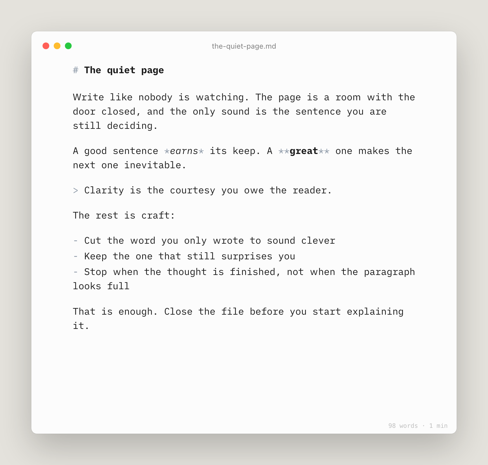

<p align="center">
  
</p>

# Writer

A simple place with no AI. If there is any, you know.

Authentic thoughts. Yours.

**Primary target: Omarchy / Arch Linux** (Tauri 2 + TypeScript + CodeMirror). The original macOS Swift/AppKit app remains in `Sources/` for reference.

<p align="center">
  
</p>

## Linux (Omarchy / Arch)

### Dependencies

```sh
sudo pacman -S --needed webkit2gtk-4.1 base-devel curl wget file openssl \
  appmenu-gtk-module libappindicator-gtk3 librsvg \
  rust nodejs npm
```

### Run

```sh
git clone https://github.com/PiemonteF/writer.git
cd writer
make linux-run
```

That installs npm deps and starts the Tauri app. Other targets:

```sh
make linux-app    # release binary + deb/rpm/AppImage under linux/src-tauri/target/release/
make linux-test   # frontend build + pure-logic smoke tests
make clean
```

Open any `.md`, `.markdown`, or `.txt` file, or start typing. The library defaults to `~/Documents/Writer`.

Details: [`linux/README.md`](linux/README.md).

### What works on Linux

- Markdown editor with iA Writer Duo / Quattro / Mono fonts
- Library sidebar with search
- Preview (Ctrl+R)
- Focus Mode (Ctrl+D) — sentence / paragraph
- Style Check (Alt+Shift+Ctrl+D)
- Night Mode (Alt+Ctrl+N), Typewriter (Alt+Ctrl+T)
- Word count and reading time (Shift+Ctrl+C)
- Commands palette (Ctrl+/)

Still Mac-only for now: authorship coloring, parts-of-speech highlight, live Markdown preview, heading tree, PDF export.

## macOS (legacy)

Requires macOS 14+ and Xcode 16 at `/Applications/Xcode.app`.

```sh
make macos-run    # build build/Writer.app and open
make macos-test   # Swift pure-function tests
```

Or download `Writer-macOS.zip` from [Releases](../../releases/latest).

Authorship, ⇧⌘A. What you typed stays black. What was pasted or generated is in color. Rewrite it and it becomes yours again.

## Shortcuts (Linux)

| Action | Key |
| --- | --- |
| Commands | Ctrl+/ |
| Focus Mode | Ctrl+D |
| Preview | Ctrl+R |
| Night Mode | Alt+Ctrl+N |
| Typewriter Mode | Alt+Ctrl+T |
| Library | Alt+Ctrl+L |
| Style Check | Alt+Shift+Ctrl+D |
| Word Count | Shift+Ctrl+C |

## Layout

See `docs/DESIGN.md` (macOS architecture) and the Omarchy port note in the project store when published with this work.
